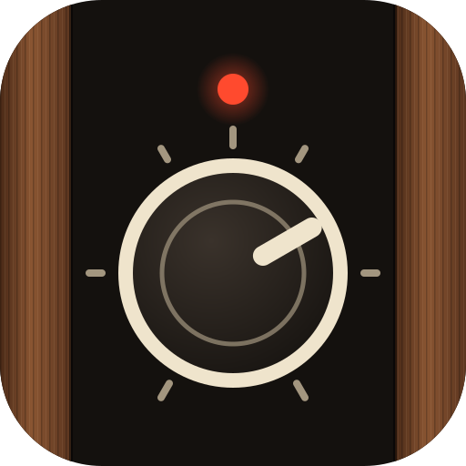

# FoogerBox

Three classic Moog-style effects in one pedal: a **filter**, a **phaser** and a **ring modulator**. Switch 1 picks the effect; the knobs and the other two switches then shape it. Built on the Cleveland Music Co. Hothouse.

**[Open the guide app](https://brandenchan.github.io/foogerbox-guide/)** · [PDF guide](FoogerBox-Guide.pdf)

## In two minutes

1. Instrument into the right jack, amp from the left, 9 V in the middle.
2. Press the left footswitch: the left LED lights, the effect is on.
3. Flip switch 1 to pick filter, phaser or ring mod.
4. Dial in a preset for that effect: the cards show every knob and switch.
5. Match your bypass volume with knob 6.

## The pedal

<table><tr><td valign="top"></td><td valign="top">

| | | |
|-|-|-|
| **A** | **Output** | to your amp |
| **B** | **Power** | 9 V DC, centre negative. Needed even when off. |
| **C** | **Input** | from your instrument |
| **D** | **Knobs** | change with the effect. 1 is drive, 6 is output. |
| **E** | **Switch 1** | the effect: up filter, middle phaser, down ring mod |
| **F** | **Switches 2 and 3** | options for that effect |
| **G** | **Left LED** | effect on |
| **H** | **Right LED** | envelope or sweep |
| **I** | **Left footswitch** | on / off |
| **J** | **Right footswitch** | tap tempo |

</td></tr></table>

## Filter

*MF-101 style* · **Switch 1 up**

A resonant Moog ladder filter with an envelope: warm tone shaping, auto-wah that follows your playing, and saturated growl.

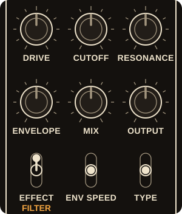

**Tap tempo:** Not used. **Right LED:** Glows with your playing (the envelope).

| Control | | What it does |
|-|-|-|
| Knob 1 | **Drive** | How hard you hit the filter. Adds grit and volume, and makes the envelope react more. 0 dB at noon. |
| Knob 2 | **Cutoff** | Brightness. Left is dark and bassy, right wide open. Most of the action is between 9 and 3 o'clock. |
| Knob 3 | **Resonance** | A singing peak at the cutoff. Subtle below 3, vocal around 5-7, whistles on its own from about 9. |
| Knob 4 | **Envelope** | Off at noon. Right: playing harder opens the filter (wah). Left: playing harder closes it. |
| Knob 5 | **Mix** | Dry (left) to all filter (right). Halfway keeps your low end solid under the effect. |
| Knob 6 | **Output** | Volume, 0 dB at noon. Match bypass after changing drive. |
| Switch 2 | **Envelope speed** | Up smooth, middle medium, down fast. |
| Switch 3 | **Filter type** | Up 4-pole (deep, smooth), middle 2-pole (brighter, vocal), down bandpass (thin, quacky). |

### Filter presets

<table>
<tr><td valign="top" width="50%"><b>Bass auto-wah</b> Bass, guitar  The classic envelope filter: each note blooms open and closes as it fades.   Drive sets how far it opens. Sticks open: less. Barely moves: more.</td><td valign="top" width="50%"><b>Synth strum</b> Omnichord, keys  Every strum opens a resonant filter like a synth's filter envelope, then it settles as the chord rings out.   If it stays bright between strums, turn drive down a little.</td></tr>
<tr><td valign="top" width="50%"><b>Funk quack</b> Bass, funk guitar  A tight vocal quack on every pluck. Made for slap and staccato lines.   Dig in: the harder you play, the bigger the quack.</td><td valign="top" width="50%"><b>Synth squelch</b> Bass, synth lines  Resonant and rubbery: every note snaps the filter open like a synth-bass envelope.  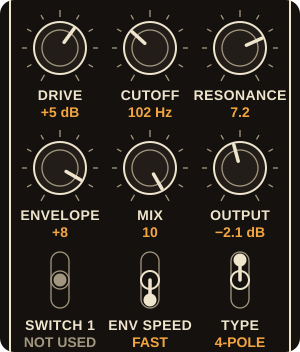 More resonance is wilder, but past about 8 it whistles between notes.</td></tr>
<tr><td valign="top" width="50%"><b>Grind</b> Bass, synth lines  Saturated and dark: a fuzzy synth-bass growl.   Drive adds a lot of volume; keep output low.</td><td valign="top" width="50%"><b>Telephone</b> Any  Thin, mid-focused and a little gritty, like an old radio or a phone line. No movement.  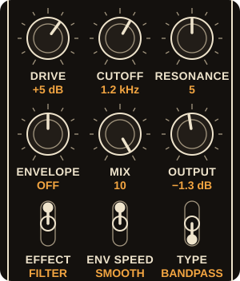 Cutoff moves the band. On chords, bring output down a touch.</td></tr>
</table>

## Phaser

*MF-103 style* · **Switch 1 middle**

A 6 or 12-stage phaser: slow swirls, deep jet sweeps, rotary-speaker warble and audio-rate grit.

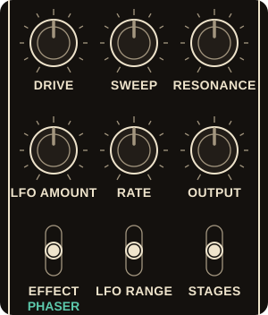

**Tap tempo:** Sets the rate (knob 5). **Right LED:** Blinks with the sweep.

| Control | | What it does |
|-|-|-|
| Knob 1 | **Drive** | Input level into the phaser. Above noon it adds warmth and grit. |
| Knob 2 | **Sweep** | Where the notches sit: low is throaty, high is airy. With the LFO off, this is the sound. |
| Knob 3 | **Resonance** | Sharper, more vocal peaks between the notches. |
| Knob 4 | **LFO amount** | How far the sweep moves. Fully left it stands still. |
| Knob 5 | **Rate** | Speed of the sweep: 0.01-2.5 Hz on Lo, 1-250 Hz on Hi. Tap tempo overrides it. |
| Knob 6 | **Output** | Volume, 0 dB at noon. Runs louder than bypass: start around 10 o'clock. |
| Switch 2 | **LFO range** | Up Lo (slow), middle Hi (fast, up to audio rate), down LFO off (a fixed notch). |
| Switch 3 | **Stages** | Up 6 (classic), middle 12 (deeper), down 12 with inverted resonance (hollow). |

### Phaser presets

<table>
<tr><td valign="top" width="50%"><b>Slow swirl</b> Omnichord, keys, guitar  The classic: a gentle, wide phase that turns over every 12 seconds.  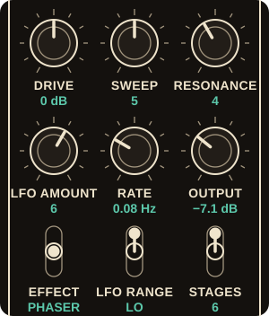 Raise the rate for more motion; noon is about one sweep in 3 seconds.</td><td valign="top" width="50%"><b>Deep 12-stage</b> Guitar, bass  Twice the stages: a deeper, more dramatic jet sweep.  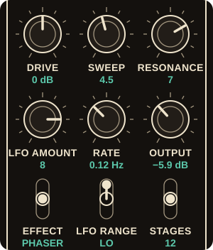 Resonance makes it more vocal; above 8 it gets intense.</td></tr>
<tr><td valign="top" width="50%"><b>Rotary warble</b> Omnichord, keys, guitar  A fast shimmer, about 5 Hz, like a spinning speaker.  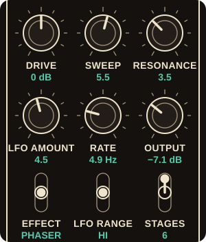 Rate a little lower for a slow-speed chorale.</td><td valign="top" width="50%"><b>Fixed notch</b> Bass, guitar  No movement: a fixed nasal tone, like a wah pedal left half down.  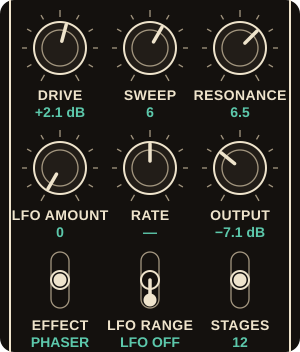 Sweep picks the vowel.</td></tr>
<tr><td valign="top" width="50%"><b>Tap-tempo throb</b> Any  A deep, hollow pulse locked to the song.  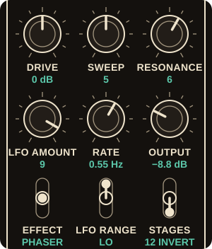 Tap the right footswitch on the beat; the sweep follows your taps.</td><td valign="top" width="50%"><b>Audio-rate grit</b> Guitar, noise  The sweep runs at audio rate: metallic, ring-mod-like overtones.  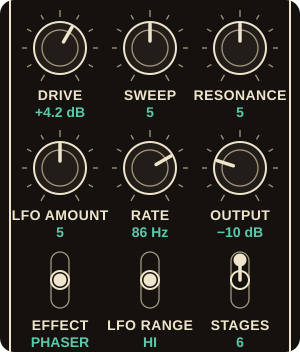 Turn the rate knob slowly for sci-fi effects.</td></tr>
</table>

## Ring mod

*MF-102 style* · **Switch 1 down**

Multiplies your sound with a second tone: choppy tremolo, bells, clang and talking robots.

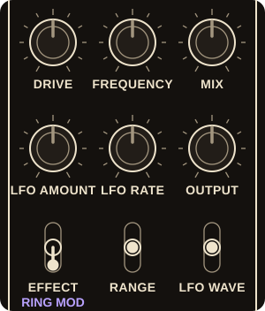

**Tap tempo:** Sets the LFO rate (knob 5). **Right LED:** Blinks with the LFO.

| Control | | What it does |
|-|-|-|
| Knob 1 | **Drive** | Input level into the ring modulator. Above noon it adds grit. 0 dB at noon. |
| Knob 2 | **Frequency** | Pitch of the second tone (the carrier). Low settings chop, high settings clang. |
| Knob 3 | **Mix** | Dry (left) to all ring mod (right). The dry sound stays strong until past noon. |
| Knob 4 | **LFO amount** | How far the LFO bends the carrier's pitch, up to an octave either way. Fully left is off. |
| Knob 5 | **LFO rate** | Speed of the wobble, 0.1-25 Hz. Tap tempo overrides it. |
| Knob 6 | **Output** | Volume, 0 dB at noon. |
| Switch 2 | **Range** | Up Lo: 0.6-80 Hz, a choppy tremolo. Middle or down Hi: 30 Hz-4 kHz, bells and robots. |
| Switch 3 | **LFO waveform** | Up sine, middle square (jumps between two pitches), down triangle. |

### Ring mod presets

<table>
<tr><td valign="top" width="50%"><b>Choppy tremolo</b> Guitar, Omnichord  A low carrier chops the sound into a stuttering tremolo.  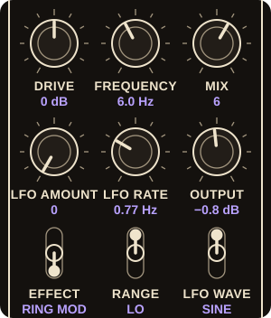 Frequency sets the chop speed.</td><td valign="top" width="50%"><b>Metallic bell</b> Omnichord, single notes  Clangorous, bell-like overtones. Try slow single notes.  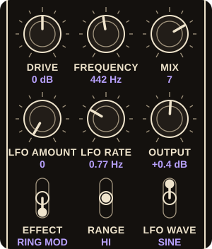 Every note gives a different chime: that is the charm.</td></tr>
<tr><td valign="top" width="50%"><b>Robot wobble</b> Bass, voice  A talking-robot tone with a slow wobble.  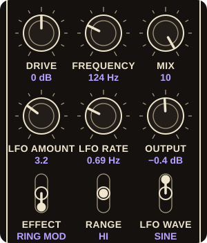 LFO amount to zero for a steady robot.</td><td valign="top" width="50%"><b>Two-note warble</b> Guitar, effects  The square LFO flips the carrier between two pitches: a sci-fi alarm.  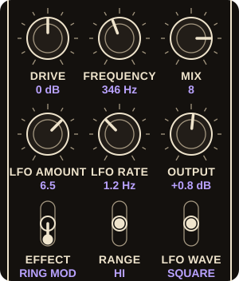 Tap tempo locks the flips to the beat.</td></tr>
</table>

## Good to know

**Drive sets the wah's reach.**  
Filter stays open: less drive. Barely moves: more drive.

**Whistling? Less resonance.**  
From about 9 the filter sings on its own. Usable, but loud.

**Hot sources need less drive.**  
Line-level gear like an Omnichord hits harder than a guitar. Start drive below noon.

**The phaser runs hot.**  
Wet and dry add up. Start its output around 10 o'clock.

**Tap to sync.**  
Two or more taps on the right footswitch set the phaser or ring mod speed. Turn the rate knob to take over again.

**LEDs flashing, no sound? Replug.**  
Holding the left footswitch for 2 seconds enters update mode. Unplug the power and plug it back in.

**The knobs are the memory.**  
Nothing is saved. Photograph a setting you like.

**Lo range chops, Hi range rings.**  
Below about 20 Hz the ring mod is a choppy tremolo; above, it makes new, clangy pitches.

---

FoogerBox firmware for the Cleveland Music Co. Hothouse. The filter, phaser and ring mod are tuned against Moog's MF-101S, MF-103S and MF-102S plugins, and the figures on the preset cards read in those plugins' units. Inspired by the Moogerfooger MF-101, MF-102 and MF-103; not affiliated with Moog Music. Moog and Moogerfooger are trademarks of Moog Music Inc.

This README, the images and the [guide app](https://brandenchan.github.io/foogerbox-guide/) all come from `guide.js`; `node build_docs.js` regenerates the README and images.
