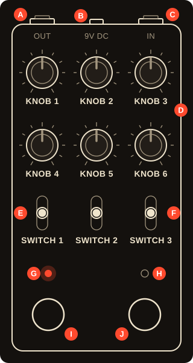
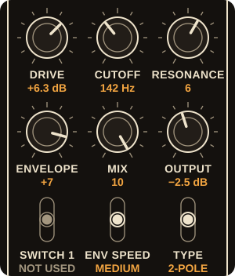
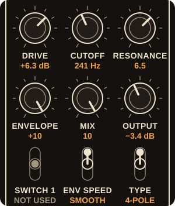
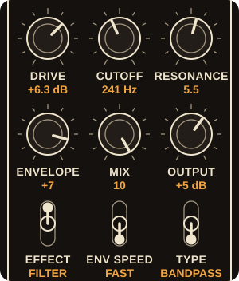
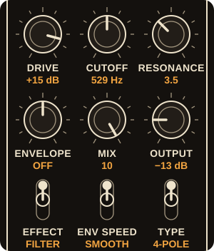

# FoogerBox

A classic Moog-style filter in a pedal: a resonant ladder filter with an envelope that follows your playing. More effects are coming in a later update. Built on the Cleveland Music Co. Hothouse.

**[Open the guide app](https://brandenchan.github.io/foogerbox-guide/)** · [PDF guide](FoogerBox-Guide.pdf)

## In two minutes

1. Instrument into the right jack, amp from the left, 9 V in the middle.
2. Press the left footswitch: the left LED lights, the filter is on.
3. Dial in a preset: the cards show every knob and switch.
4. Play harder and softer: the right LED glows with the envelope.
5. Match your bypass volume with knob 6.

## The pedal

<table><tr><td valign="top"></td><td valign="top">

| | | |
|-|-|-|
| **A** | **Output** | to your amp |
| **B** | **Power** | 9 V DC, centre negative. Needed even when off. |
| **C** | **Input** | from your instrument |
| **D** | **Knobs** | the filter's six controls |
| **E** | **Switch 1** | not used yet |
| **F** | **Switches 2 and 3** | envelope speed and filter type |
| **G** | **Left LED** | filter on |
| **H** | **Right LED** | glows with your playing |
| **I** | **Left footswitch** | on / off |
| **J** | **Right footswitch** | not used yet |

</td></tr></table>

## Filter

*MF-101 style*

A resonant Moog ladder filter with an envelope: warm tone shaping, auto-wah that follows your playing, and saturated growl.

**Tap tempo:** Not used. **Right LED:** Glows with your playing (the envelope).

| Control | | What it does |
|-|-|-|
| Knob 1 | **Drive** | How hard you hit the filter. Adds grit and volume, and makes the envelope react more. 0 dB at noon. |
| Knob 2 | **Cutoff** | Brightness. Left is dark and bassy, right wide open. Most of the action is between 9 and 3 o'clock. |
| Knob 3 | **Resonance** | A singing peak at the cutoff. Subtle below 3, vocal around 5-7, whistles on its own from about 9. |
| Knob 4 | **Envelope** | Off at noon. Right: playing harder opens the filter (wah). Left: playing harder closes it. |
| Knob 5 | **Mix** | Dry (left) to all filter (right). Halfway keeps your low end solid under the effect. |
| Knob 6 | **Output** | Volume, 0 dB at noon. Match bypass after changing drive. |
| Switch 2 | **Envelope speed** | Up smooth, middle medium, down fast. |
| Switch 3 | **Filter type** | Up 4-pole (deep, smooth), middle 2-pole (brighter, vocal), down bandpass (thin, quacky). |

### Filter presets

<table>
<tr><td valign="top" width="50%"><b>Bass auto-wah</b> Bass, guitar  The classic envelope filter: each note blooms open and closes as it fades.   Drive sets how far it opens. Sticks open: less. Barely moves: more.</td><td valign="top" width="50%"><b>Synth strum</b> Omnichord, keys  Every strum opens a resonant filter like a synth's filter envelope, then it settles as the chord rings out.   If it stays bright between strums, turn drive down a little.</td></tr>
<tr><td valign="top" width="50%"><b>Funk quack</b> Bass, funk guitar  A tight vocal quack on every pluck. Made for slap and staccato lines.   Dig in: the harder you play, the bigger the quack.</td><td valign="top" width="50%"><b>Synth squelch</b> Bass, synth lines  Resonant and rubbery: every note snaps the filter open like a synth-bass envelope.   More resonance is wilder, but past about 8 it whistles between notes.</td></tr>
<tr><td valign="top" width="50%"><b>Grind</b> Bass, synth lines  Saturated and dark: a fuzzy synth-bass growl.   Drive adds a lot of volume; keep output low.</td><td valign="top" width="50%"><b>Telephone</b> Any  Thin, mid-focused and a little gritty, like an old radio or a phone line. No movement.   Cutoff moves the band. On chords, bring output down a touch.</td></tr>
</table>

## Good to know

**Drive sets the wah's reach.**  
Filter stays open: less drive. Barely moves: more drive.

**Whistling? Less resonance.**  
From about 9 the filter sings on its own. Usable, but loud.

**Hot sources need less drive.**  
Line-level gear like an Omnichord hits harder than a guitar. Start drive below noon.

**LEDs flashing, no sound? Replug.**  
Holding the left footswitch for 2 seconds enters update mode. Unplug the power and plug it back in.

**The knobs are the memory.**  
Nothing is saved. Photograph a setting you like.

**Spare controls.**  
Switch 1 and the right footswitch do nothing yet. They are kept for effects coming in a later update.

---

FoogerBox firmware for the Cleveland Music Co. Hothouse. The filter is tuned against Moog's MF-101S plugin, and the figures on the preset cards read in its units. Inspired by the Moogerfooger MF-101; not affiliated with Moog Music. Moog and Moogerfooger are trademarks of Moog Music Inc.

This README, the images and the [guide app](https://brandenchan.github.io/foogerbox-guide/) all come from `guide.js`; `node build_docs.js` regenerates the README and images.
